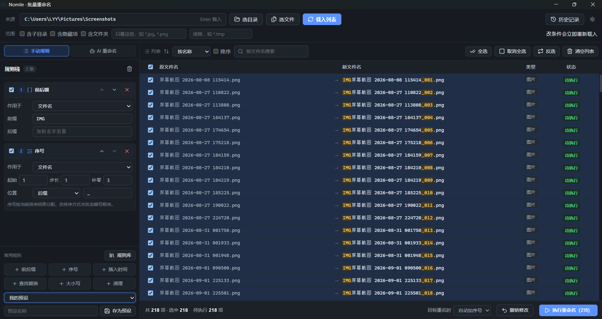

<div align="center">
  

  <h1>Nomile</h1>
</div>

Windows 桌面端的批量重命名工具。规则只在 Rust 里算一次，预览和执行调的是同一个 `build_plan`，所以列表里看到的名字，就是最终落地的名字。



## 特性

- **规则栈**：17 种规则自由叠加、上下拖动排序，改一条立刻重算
- **实时预览**：原名 → 新名并排显示，只高亮真正改动的片段；带文件类型列
- **永不覆盖**：目标重名默认自动加序号，也可以选择跳过，没有“覆盖”选项
- **执行可撤销**：每次执行写 WAL 日志，执行后底部弹出带倒计时的撤销入口，过期后仍可在「历史记录」里撤销
- **规则库 + 我的预设**：常用 6 条固定在底部，其余从规则库分组里挑；规则栈可存成自己的预设
- **元数据命名**：直接用 EXIF 拍摄时间、音视频标签（标题/艺术家/专辑/时长）等变量拼名字，只有规则真的用到才读文件
- **AI 命名**：一句话生成命名母模板；也可以读取文件内容后逐份起名
- 明暗主题切换、窗口尺寸记忆

## 安装

到 Releases 下载 `Nomile_0.1.0_x64-setup.exe`（推荐）或 `Nomile_0.1.0_x64_en-US.msi`。

系统要求：Windows 10 / 11 x64，WebView2 运行时（Win11 自带）。

> 安装包未做代码签名，SmartScreen 提示“未知发布者”属正常现象。

## 怎么用

1. **选来源**：选目录，或直接选一批文件。目录模式下还能收紧范围——含子目录 / 含隐藏项 / 含文件夹 / 只匹配 `*.jpg,*.png` / 排除 `*.tmp`
2. **加规则**：左侧规则栈，从底部常用区或规则库里添加，可叠加、可调序
3. **看预览**：右侧列表显示「原名 → 新名」，改动处高亮；类型列告诉你是图片还是文档
4. **执行**：确认无冲突后点「执行重命名」；底部提示带倒计时撤销，过期就去「历史记录」

> 「范围」决定哪些文件被载入，「列表」工具条（排序 / 搜索 / 全选 / 反选 / 清空）只决定怎么看待这批已载入的文件，不影响执行范围。

## 规则

| 规则 | 说明 | 规则 | 说明 |
|---|---|---|---|
| 查找替换 | 文本或正则替换，支持捕获组 | 前后缀 | 在名字头尾加固定文字 |
| 序号 | 前缀 / 后缀 / 替换整名，可补零、可设步长 | 模板 | 用 `${name}` `${n:3}` `${date}` 等变量拼整名 |
| 大小写 | 全大写 / 全小写 / 首字母大写 / 句首大写 | 清理 | 空格转下划线、去非法字符、去首尾空格、压缩重复 |
| 按位置截取 | 保留或删掉指定字符区间 | 指定位置插入 | 在固定位置插入文字 |
| 删除括号内容 | 连同括号一起删掉 | 清除副本标记 | 去掉「 - 副本」「(2)」这类痕迹 |
| 限制长度 | 卡住名字长度，避免路径超限 | 设置扩展名 | 统一改成指定扩展名 |
| 统一分隔符 | 空格 / 下划线 / 连字符统一成一种 | 剥掉固定前后缀 | 精确剥掉开头或结尾的固定文字 |
| 插入时间 | 按修改 / 创建 / 当前时间加时间戳 | AI 命名方案 | 自然语言生成的母模板 |
| AI 按内容命名 | 读文件内容后逐份起名 | | |

**元数据变量**：`${shot}`（EXIF 拍摄时间）、`${camera}`、`${title}`、`${artist}`、`${album}`、`${track}`、`${duration}`、`${width}` 等，从图片 EXIF 和音频/视频标签里取。按需读取：规则里没用到就不打开文件。

## AI 命名

在左侧切到「AI」，有两个入口：

- **自然语言 → 母模板**：说一句“按拍摄时间排序，名字用日期加三位序号”，AI 把它拆成槽位组合，你能看到拆出来的结构再决定用不用
- **按内容命名**：支持读取文本、PDF、DOCX、PPTX、XLSX/XLS 的内容后逐文件起名（图片、音视频、旧版 DOC/PPT 不读）。内容只用于当次请求，AI 只返回文件名，不会修改文件

使用前在 AI 设置里配置服务：内置 Ollama 等预设，也支持 OpenAI 兼容的自定义 Base URL + 模型。API Key 存在系统凭据管理器，不写进配置文件。

## 开发

```bash
pnpm install
pnpm tauri dev              # 开发模式
pnpm exec tsc --noEmit      # 前端类型检查
cd src-tauri; cargo test    # Rust 单测
pnpm tauri build            # 打包（产物在 src-tauri/target/release/bundle）
```

## 结构

```
src-tauri/src/
├── model.rs        前后端共享契约（rename_all = camelCase）
├── domain/         纯函数：取名规则、母模板、计划构建与校验
└── infra/          IO：扫描、两阶段执行、撤销日志、配置、元数据、AI 调用

src/
├── lib/            与 model.rs 逐字段对应的手写类型、IPC、主题
├── store/          zustand 状态
└── features/       工具栏 / 规则栈 / 规则库 / 预览表 / 历史抽屉 / AI 面板
```

## 说明

- 目前只支持 Windows（两阶段改名与撤销日志按 Windows 路径与文件语义实现）
- AI 功能不内置 Key，需要自行配置服务
- 改名操作有撤销日志保护，但仍建议先在小批量上验证规则效果
